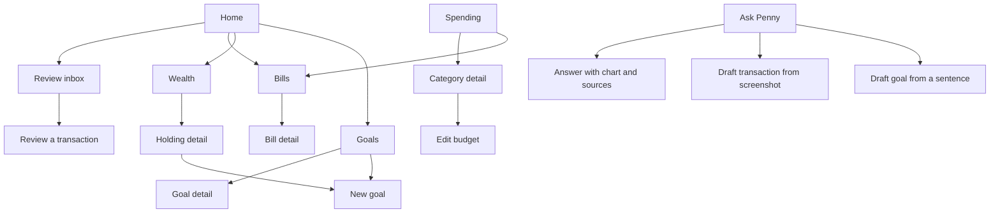
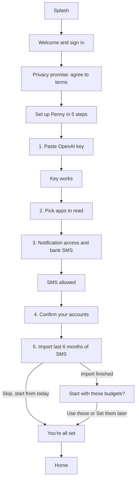
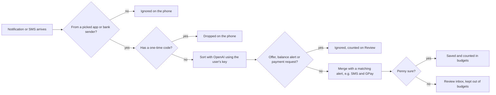

# Penny: user flows and features

Penny tracks where your money goes without you typing anything. It reads bank SMS and payment-app alerts on the phone, sorts each one into a transaction, and builds budgets, bills, goals and net worth from them. It is read-only: it never moves money.

- **Source**: the "Penny · Screens" design ([artifact](https://claude.ai/artifact/DKFn6XzjniTAFQRnVubxyh)), 29 screens as of 18 Nov 2026. Figures in it are sample data.
- **Status**: draft, written 19 Nov 2026. Open questions are at the end.

## Principles

These come from the privacy-promise screen and the guardrails in `CLAUDE.md`. Every feature below has to respect them.

1. **Data stays on the phone.** No Penny server sees transactions.
2. **Penny reads only what the user picks.** Chosen bank, UPI and investment apps, plus bank SMS from bank senders. WhatsApp, Gmail, chats and personal SMS are never read.
3. **One-time codes are dropped on the phone** before any other processing, and never stored or sent.
4. **The only thing that leaves the phone** is a message's text, sent to OpenAI with the user's own API key, to sort it.
5. **Read-only.** Penny never sends money, pays a bill, or changes a mandate. It points the user to their bank's app instead.
6. **AI drafts, the user confirms.** Anything Ask Penny creates is a draft marked "Not saved" until the user taps Confirm.
7. **Show the source.** Wherever Penny guesses, it shows the message, statement or price file it read.

## App map

A bottom bar with five tabs. Home also has Profile, Hide amounts and Notifications buttons in its top bar.

| Tab       | Screen               | What it shows                                                                                                         |
| --------- | -------------------- | --------------------------------------------------------------------------------------------------------------------- |
| Home      | Home                 | Review banner, left to spend this month with daily allowance and pace, goals, bills to go, net worth, recent activity |
| Home      | Review inbox         | Transactions Penny wasn't sure about, plus what it sorted on its own in the last 7 days                               |
| Home      | Review a transaction | One unsure transaction: Penny's guess and why, the raw message, and pickers to fix it                                 |
| Spending  | Spending & budgets   | Month spent vs plan, 6-month chart, budgets with a pace tick, money not counted as spending                           |
| Spending  | Category detail      | One category: vs last and usual month, top merchants, its transactions                                                |
| Spending  | Edit budget          | Set a category's monthly amount against 6 months of history                                                           |
| Spending  | Bills                | Month calendar of due and paid bills, coming up, paid, subscriptions and mandates                                     |
| Spending  | Bill detail          | One bill: amount history, the pre-debit notice, mandate details                                                       |
| Goals     | Goals                | Total saved toward all goals, each goal's progress and pace, money not in any goal                                    |
| Goals     | Goal detail          | Target, date, monthly amount needed vs usual pace, linked investments, history                                        |
| Goals     | New goal             | Name, target, date, and how to save: link investments (with a % share) or track by hand                               |
| Wealth    | Net worth            | Net worth split into what you saved and market change, where it sits, holdings, bank balances                         |
| Wealth    | Holding detail       | One fund or stock: units, price, gain, which goals it funds, where each number came from                              |
| Ask Penny | Ask Penny            | Questions about your money, answered from on-phone data with a chart and the steps behind it                          |
| Ask Penny | Screenshot draft     | A payment screenshot turned into a draft transaction, with a duplicate check                                          |
| Ask Penny | Goal draft           | A sentence ("Save 60k for a bike by June") turned into a draft goal                                                   |

## User flows

### 1. First launch and setup

About 3 minutes, and the user can stop and come back. Steps 1 to 5 show a "n / 5" counter.

1. **Splash**, then **Welcome**: "Know where your money goes, without typing a thing." Continue with Google, or email and password (log in, create account, forgot password).
2. **Privacy promise**: the principles above in plain words. The user ticks "I've read this and the terms" and taps Agree and continue.
3. **Setup steps**: an overview of the five steps.
4. **OpenAI key** (1/5): paste the key, tap Check key. Penny makes a test call and shows the model and latency ("Your key works"). The key is stored encrypted on the phone, never logged or backed up. Cost is under a paisa per message, paid to OpenAI directly.
5. **Apps to read** (2/5): toggles for detected banking, UPI and investment apps (e.g. HDFC Bank, YONO SBI, Google Pay, PhonePe, Groww, CRED) and for bank SMS. A "Never read" box lists what is always excluded.
6. **Alerts and SMS** (3/5): grant notification access, then SMS. For sideloaded installs Android blocks SMS until the user allows restricted settings in App info, so the screen walks through those 3 steps. A third row asks for unrestricted battery so Android doesn't kill Penny.
7. **Your accounts** (4/5): bank accounts, cards and UPI IDs Penny found, with last balances. The user confirms which are theirs, flags unsure ones and adds missed ones. This is what lets Penny treat money between them as a transfer, not spending or income.
8. **Import history** (5/5): read the last 6 months of bank SMS, with live counts (messages read, transactions found, codes dropped). It can keep going in the background, or the user can skip and start from today.
9. **Starting budgets**: one budget per main category from the 6-month average, rounded up a little, plus the month's total split into bills and everything else. The user edits, accepts or sets them later.
10. **All set**, then Home.

### 2. Everyday: payments sort themselves

There is no "add transaction" button. Capture is passive:

- Each transaction gets a **kind**: spending, income, refund, paid back, own transfer, or not real.
- Transfers between the user's own accounts, credit card bill payments and SIPs are **not counted as spending**.
- Autopay debits are matched to their bill and mark it paid.
- Balance SMS updates the bank balances in Wealth.

### 3. Review what Penny wasn't sure about

1. Home shows a banner, "2 transactions need a look", when the inbox isn't empty.
2. **Review inbox** lists the unsure items. Simple ones get one-tap answers inline (e.g. "Did Rahul pay you back, or is this income?" → Paid me back / Income, with Penny's guess on the left). Others get "Sort it out".
3. **Review a transaction** shows Penny's guess and reasoning, the exact message it read, and lets the user set who it was, what kind of money it is and the category. "Remember this" applies the same name and category to future payments to that UPI ID. Then Save and next, or Skip for now.
4. Below the queue, **Sorted by Penny (last 7 days)** shows decisions Penny made alone (merged alerts, own transfers, autopay matched to a bill, alerts ignored). Tapping one lets the user correct it.

### 4. Check spending and adjust a budget

1. **Home** answers "how much can I still spend": left to spend this month, per-day allowance for the days left, and whether the user is on pace.
2. **Spending** shows the month against the plan and the usual month, then budgets split into Bills & subscriptions and Everyday. Each budget bar has a tick for where spending should be today, and a status (on track, ahead of pace, over). Tabs: Budgets, Categories, Merchants, Bills.
3. Tap a category for **Category detail**: last month, usual month, 6-month chart, top merchants and its transactions.
4. **Edit budget**: change the amount in steps of ₹500. Penny shows how often that amount would have been exceeded over the last six months. Apply to this month or every month, then save.

### 5. Keep track of bills

1. Penny finds bills, subscriptions and mandates from autopay and pre-debit messages.
2. **Bills** shows a month calendar (due, paid, today), what's coming up with how each is paid, what's already paid, and the list of subscriptions and mandates.
3. **Bill detail** shows the amount over 6 months (and explains outliers), the pre-debit notice Penny read, and the mandate: set-up date, limit, charge day, last payment. Penny says plainly that it only reads mandates; changing or cancelling one happens in the bank's app. The user can edit the bill or stop tracking it.

### 6. Save toward a goal

1. **Goals** shows total saved, this month's change (and how much of it was the market), and a card per goal with progress and pace. It also shows investments not in any goal.
2. **New goal**: picture, name, target and date. Penny works out the monthly amount. Choose how to save:
   - **Link investments**: assign a % of a fund or stock. The goal's value moves with the market.
   - **Track by hand**: the user adds money as they save.
3. **Goal detail**: the monthly amount needed vs the usual pace, a projection chart, what's in the goal (linked holdings, manual entries), contributions vs market change, and history. Actions: Add money, Edit goal.

### 7. See net worth and update holdings

1. **Net worth** splits the month's change into what the user saved and what the market did, shows a 6-month chart, and where the money sits (mutual funds, stocks, bank balances).
2. Prices refresh every evening from public price files. Units change only when the user shares a new **screenshot** or imports a **CAS PDF** statement, or when an allotment SMS arrives (e.g. a SIP).
3. **Holding detail** shows units, price, gain, which goals the holding funds (with "Change split" and unassigned share), and where each number came from.

### 8. Ask Penny

A chat tab for questions and quick entry. Every answer is built from on-phone data and says so.

- **Questions**: "Why is travel over this month?" gets a short answer, a chart, the steps Penny took (which transactions it read), and follow-up suggestions. Totals are added up by the app, not estimated by the model.
- **Missed payment from a screenshot**: the user shares a payment screenshot. Penny reads it, checks for a duplicate across accounts around that date, and shows a draft transaction (Not saved) with Confirm, Edit, Discard.
- **Goal from a sentence**: "Save 60k for a bike by June" becomes a draft goal with the monthly amount. Penny states how it read the numbers and dates and asks only for what's missing (how to save).

## Features

Phase is a proposal (see open questions). **v1** is enough to replace typing expenses; **v2** adds goals, wealth and chat.

| Area      | Feature                                                       | Screens                   | Phase |
| --------- | ------------------------------------------------------------- | ------------------------- | ----- |
| Setup     | Sign in with Google or email                                  | Welcome                   | v1    |
| Setup     | Privacy promise and terms                                     | Privacy                   | v1    |
| Setup     | Bring your own OpenAI key, checked and stored encrypted       | OpenAI key, Key works     | v1    |
| Setup     | Pick which apps and SMS senders to read                       | Apps to read              | v1    |
| Setup     | Guided Android permissions (notifications, SMS, battery)      | Alerts & SMS, SMS allowed | v1    |
| Setup     | Confirm own accounts and UPI IDs                              | Your accounts             | v1    |
| Setup     | Import 6 months of SMS history in the background              | Import history            | v1    |
| Setup     | Starting budgets from 6-month averages                        | Starting budgets          | v1    |
| Capture   | Read notifications and bank SMS from picked sources           | (background)              | v1    |
| Capture   | Drop OTP messages on the phone                                | (background)              | v1    |
| Capture   | Sort messages into transactions with the user's key           | (background)              | v1    |
| Capture   | Merge duplicate alerts for one payment                        | Review (Sorted by Penny)  | v1    |
| Capture   | Detect own transfers, card payments and SIPs                  | Review, Spending          | v1    |
| Review    | Review inbox for unsure transactions, one-tap answers         | Home banner, Review inbox | v1    |
| Review    | Fix a transaction, show the source message, remember the rule | Review a transaction      | v1    |
| Review    | Correct anything Penny sorted alone                           | Review (Sorted by Penny)  | v1    |
| Spending  | Left to spend, daily allowance and pace                       | Home                      | v1    |
| Spending  | Monthly budgets per category with pace tick                   | Spending                  | v1    |
| Spending  | Category and merchant breakdowns                              | Spending, Category detail | v1    |
| Spending  | Edit a budget against 6 months of history                     | Edit budget               | v1    |
| Bills     | Find bills, subscriptions and mandates from messages          | Bills                     | v1    |
| Bills     | Bill calendar, coming up and paid                             | Bills                     | v1    |
| Bills     | Bill history, pre-debit notice and mandate details            | Bill detail               | v1    |
| Goals     | Goals with target, date and required monthly amount           | Goals, Goal detail        | v2    |
| Goals     | Fund goals with a % of investments or by hand                 | New goal, Holding detail  | v2    |
| Goals     | Projection vs usual pace                                      | Goal detail               | v2    |
| Wealth    | Net worth split into savings and market change                | Net worth                 | v2    |
| Wealth    | Holdings from CAS PDF, screenshots and allotment SMS          | Net worth, Holding detail | v2    |
| Wealth    | Daily price refresh from public price files                   | Net worth, Holding detail | v2    |
| Wealth    | Bank balances from balance SMS                                | Net worth                 | v1    |
| Ask Penny | Answer questions with a chart and the steps behind it         | Ask Penny                 | v2    |
| Ask Penny | Draft a missed transaction from a screenshot                  | Screenshot draft          | v2    |
| Ask Penny | Draft a goal from a sentence                                  | Goal draft                | v2    |
| App       | Hide amounts                                                  | Home top bar              | v1    |
| App       | Notifications                                                 | Home top bar              | v1    |

## Screens the design doesn't cover yet

Linked or implied by the design, but not drawn:

- **Settings** (OnbDone says "you can change anything in Settings"): apps read, accounts, OpenAI key, budgets, data export and delete.
- **Profile** and **Notifications** (Home top bar buttons).
- **All transactions** list and a **transaction detail** for sorted transactions ("See all" on Home and Category).
- **Create account** and **Forgot password**.
- **Edit goal**, **Add money**, **Reorder goals**.
- **Categories** and **Merchants** tabs on Spending.
- **Subscriptions & mandates** list, **Edit bill**.
- **Update holdings** flows: share screenshot, import CAS PDF.
- Empty, loading, error and offline states, and what happens when a permission is revoked or the OpenAI key stops working.

## What's built today

| Piece                    | State                                                                                                    |
| ------------------------ | -------------------------------------------------------------------------------------------------------- |
| Design system            | `packages/design-system`: tokens, components, motion, dev-only gallery in the app                        |
| Auth (API)               | Better Auth with email and password and Google, at `/api/auth/*`                                         |
| Auth (mobile)            | Sign-in and sign-up screens, session in SecureStore, `(auth)` and `(app)` route groups                   |
| Transactions             | API CRUD at `/transactions`, stored in SQLite per user: amount, currency, merchant, category, note, date |
| Everything in "Features" | Not started                                                                                              |

## Open questions

1. **Where transactions live.** The design promises "No Penny server ever sees your transactions", but the API stores them in a server database. Do we drop server storage and keep transactions in an on-phone database, with the API only for auth (or for nothing)?
2. **Do we need sign-in at all?** If all data stays on the phone, an account only matters for backup or multiple devices. Is Google/email sign-in kept, made optional, or removed?
3. **Backup and phone change.** The OpenAI key is "never backed up". What happens to transactions, budgets and goals when the user gets a new phone?
4. **Distribution.** The SMS step assumes a sideloaded install (restricted settings). Is Play Store release out of scope, given its SMS permission policy?
5. **Sorting without a key.** Can Penny do anything before the user adds an OpenAI key, e.g. rule-based parsing for common bank formats, with the model only for unclear messages?
6. **Currency and region.** The design is India-only (INR, UPI, CAS, Indian banks). Is v1 India-only?
7. **v1 scope.** Is the proposed split right: capture, review, spending, budgets and bills in v1; goals, wealth and Ask Penny in v2?
8. **Model.** The design names "gpt-6-luna". Which model and prompt does sorting use, and what's the per-message cost target?
